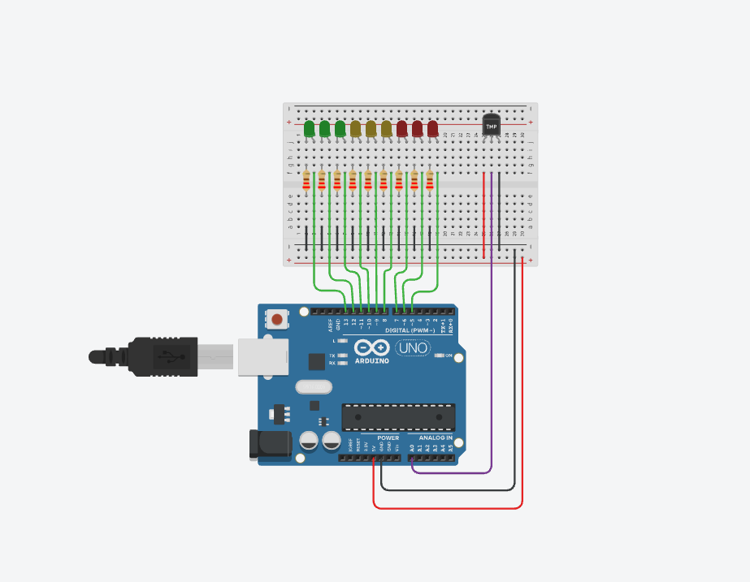
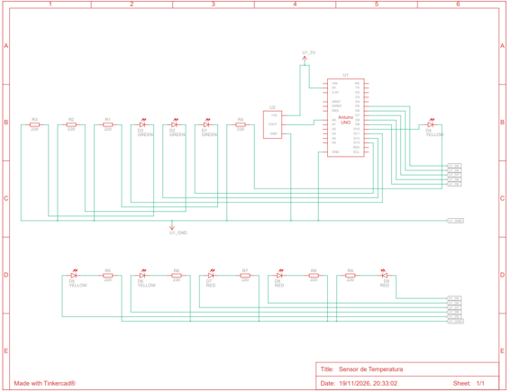
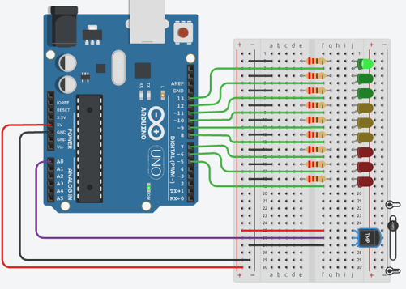
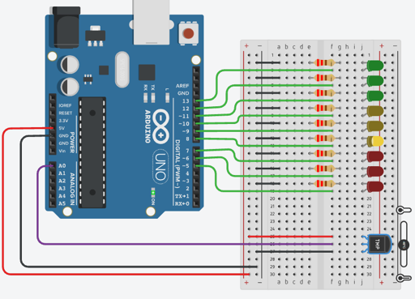

<div align="center">

# LTW - Little Tigers & Wolfs


</div>

<div align="center">

# Projeto de Extensão - LTW

**Membros/Integrantes**  

| RA | Integrante |
|------------|----|
| 2226200836 | Cicero Wagner Ferreira dos Santos |
| 2225105349 | Denis Dias dos Santos |
| 2225102897 | Guilherme Araújo do Carmo |
| 2225108340 | Henriq Bernard Oliveira Novais |
| 2225103506 | Miguel Augusto Stanichesqui Torres Nunes |
| 2225102634 | Vinicius do Nascimento Baraúna |
| 2225106336 | Simone Gomes Marques |

</div>

**Apresentação:**  

Documentação e artefatos técnicos do projeto de extensão **LTW**, voltado ao dimensionamento de infraestrutura de TI e à simulação de monitoramento ambiental para um hospital veterinário e *pet shop* Little Tigers & Wolfs.

**Descrição:**  

O **LTW** consiste no planejamento de infraestrutura e supervisão ambiental para um complexo veterinário e *pet shop* de 2.400 m² com operação contínua (24/7). Este espaço centraliza as entregas técnicas do grupo, abrangendo arquitetura, redes, sistemas operacionais, custos e simulação embarcada.

**Decisões Técnicas:** 

* **Infraestrutura e Redes:** 18 VLANs, *firewall* sob política *Implicit Deny*, SSID isolado para dispositivos sem autenticação corporativa, VPN com MFA, climatização mínima de 9.000 BTU/h na sala técnica do 3º andar (1.210 W) e adequação do *rack* (orçamento anual de referência de R$ 720.543,01, sendo R$ 697.295,65 de CAPEX e R$ 23.247,36 de OPEX).

* **Sistemas e Continuidade:** *Cluster* *N+1*, armazenamento em NAS, *backup* 3-2-1 e controle de acessos pelo modelo AGDLP.

* **IoT e Simulação (Tinkercad):** Arduino Uno R3 com sensor TMP36 (`A0`) e LEDs (`D5`–`D13`) em faixas discretas de 10 °C via `map()` em C++, com estimativa de referência de R$ 113,17 na RoboCore (28/10/2026, sem frete) e necessidade de calibração linear (10 mV/°C) em ambiente produtivo.

**Links de Acesso**

* **Tinkercad:** Sensor de Temperatura - [Acesso aqui](https://www.tinkercad.com/things/8sXVshTQ9hG-sensor-de-temperatura/editel?returnTo=https%3A%2F%2Fwww.tinkercad.com%2Fdashboard%2Fdesigns%2Fall&sharecode=7T2P7vCp9ZfeFUVbYOvlofSRBuK8pHhvKdL0MyjaS-I)

* **Video de Apresentação:** LTW - Little Tigers and Wolfs - [Acesso aqui](https://youtu.be/rBySaEswFcE) 

# Como Utilizar:

## Requisitos
Para acessar os documentos, simulações e códigos localmente, recomenda-se ter instalado:

* [Git](https://git-scm.com)
* [Arduino IDE](https://www.arduino.cc/en/software) (para compilar o código `.ino` localmente) ou conta no [Tinkercad Circuits](https://www.tinkercad.com)
* [Cisco Packet Tracer](https://www.netacad.com/cisco-packet-tracer) (para abrir o arquivo `.pkt` e validar os testes de rede)

## Clonar o Repositório
Faça uma cópia local do projeto utilizando HTTPS ou SSH:

### HTTPS
```bash

git clone https://github.com/miguelaugusto-bot/LTW-Uninove.git

```

### SSH
```bash
    git clone git@github.com:miguelaugusto-bot/LTW-Uninove.git
```
 
# Estrutura do Projeto:

```


```

# Imagens
### Circuito e Montagem
<div align="center">


<br />
<sub><em>Montagem / Referência do circuito</em></sub>
<br /><br />


<br />
<sub><em>Diagrama esquemático do circuito</em></sub>

</div>

### Testes de Simulação
<div align="center">



<br /><br />


</div>

# Créditos

**Autores:**  
Cicero Wagner Ferreira dos Santos -2226200836   
Denis Dias dos Santos - 2225105349   
Guilherme Araújo do Carmo - 2225102897  
Henriq Bernard Oliveira Novais - 2225108340   
Miguel Augusto Stanichesqui Torres Nunes - 2225103506  
Vinicius do Nascimento Baraúna - 2225102634  
Simone Gomes Marques - 2225106336  
